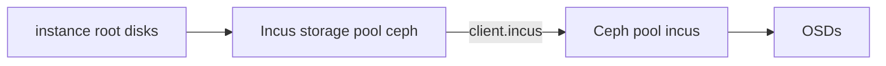

# Storage

Every instance's root disk is an RBD image in the Ceph pool `incus` ([ADR 3](../decisions/0003-store-instance-disks-in-ceph.md)). Incus reaches that pool through its own storage pool named `ceph`, which the `default` profile uses for root disks. It connects to Ceph as `client.incus`, a Ceph user that can only use RBD in the `incus` pool.

The hosts listed in `ceph.mons` and `ceph.mgrs` in `cluster.nix` run Ceph's monitors and managers, and each host's `osds` lists the OSDs it runs. Each OSD is a whole disk prepared with ceph-volume in `lvm` mode, as described in [Add an OSD](../runbooks/add-an-osd.md).

The number of copies that each pool keeps of an object is set by [ADR 6](../decisions/0006-keep-one-replica-until-three-hosts.md).

Ceph's daemons only accept msgr2 connections in `secure` mode, which encrypts all Ceph traffic, including the disk traffic between instances and OSDs. Each host's firewall only accepts Ceph's ports from cluster hosts.

The cluster's keys are in `secrets/ceph.yaml`.

This is configured in [`ceph.nix`](https://git.cmu.dev/ScottyLabs/occ/src/branch/main/modules/global/ceph.nix).
