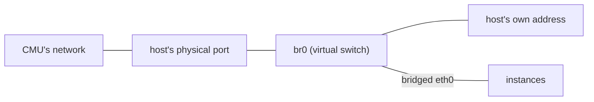
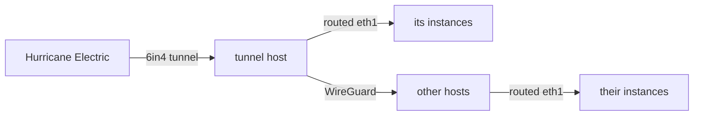

# Network

Every instance gets an IPv4 address from CMU's network and an IPv6 address from our Hurricane Electric block. The reasons are in [ADR 11](../decisions/0011-give-every-instance-a-bridged-ipv4-nic-and-a-routed-ipv6-nic.md).

## IPv4

`br0` is a Linux bridge on each host. The host's physical network port and every instance's `eth0` are ports on it, so CMU's network sees each instance as a separate device with its own MAC and gives it a routable address once its owner registers that MAC in getonline. Incus drops anything an instance sends from a MAC other than its own.

A Linux bridge has an interface of its own, also named `br0`, through which the host itself connects to the bridge. The host's address and MAC are on that interface, so `br0` is set to the physical port's MAC, which the host is registered under in getonline.

This is configured in [`bridge.nix`](https://git.cmu.dev/ScottyLabs/occ/src/branch/main/modules/global/network/bridge.nix).

## IPv6

Hurricane Electric sends all traffic for `2001:470:e2be::/48` through a 6in4 tunnel, which carries IPv6 inside IPv4, to the host named by `ipv6.tunnel.host` in `cluster.nix`. Each host has its own /64 from that block, listed as `ipv6Prefix` in `cluster.nix`.

CMU's network doesn't carry IPv6, so the tunnel host sends every other host the traffic for that host's /64 over a WireGuard connection, and the other hosts send all of their IPv6 back the same way.

Each instance's `eth1` is a routed NIC, which links the instance to its host alone. It has one address, the EUI-64 address of the instance's `eth0` MAC within its host's /64, which an admin sets with `occ-instance-ipv6` as described in [Create an instance](../runbooks/create-an-instance.md).

This is configured in [`ipv6-tunnel.nix`](https://git.cmu.dev/ScottyLabs/occ/src/branch/main/modules/global/network/ipv6-tunnel.nix), [`ipv6-wireguard.nix`](https://git.cmu.dev/ScottyLabs/occ/src/branch/main/modules/global/network/ipv6-wireguard.nix), and [`instance-ipv6.nix`](https://git.cmu.dev/ScottyLabs/occ/src/branch/main/modules/global/network/instance-ipv6.nix).
